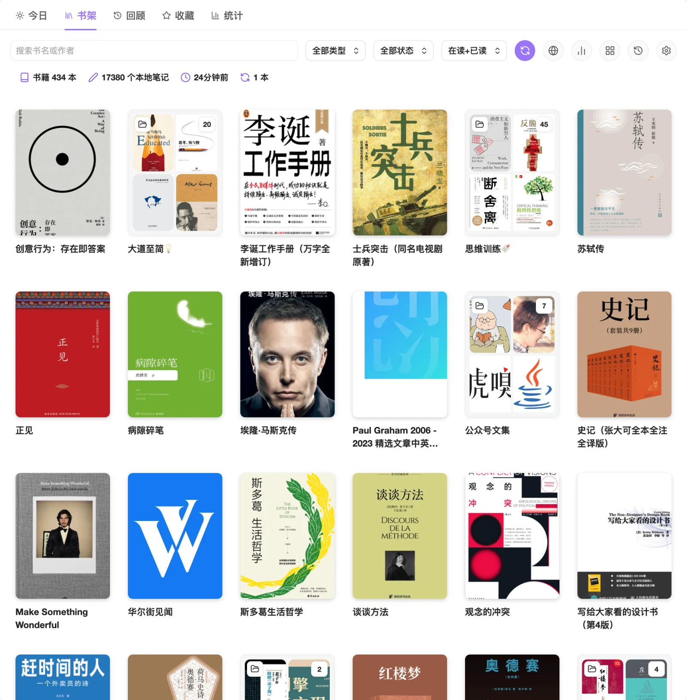
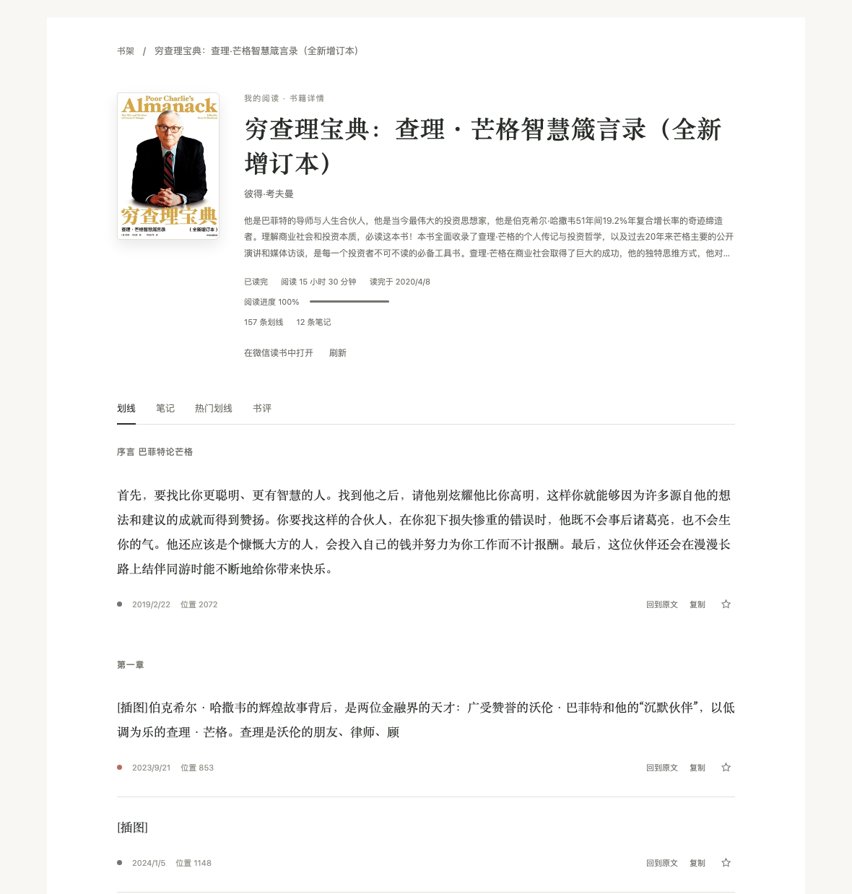
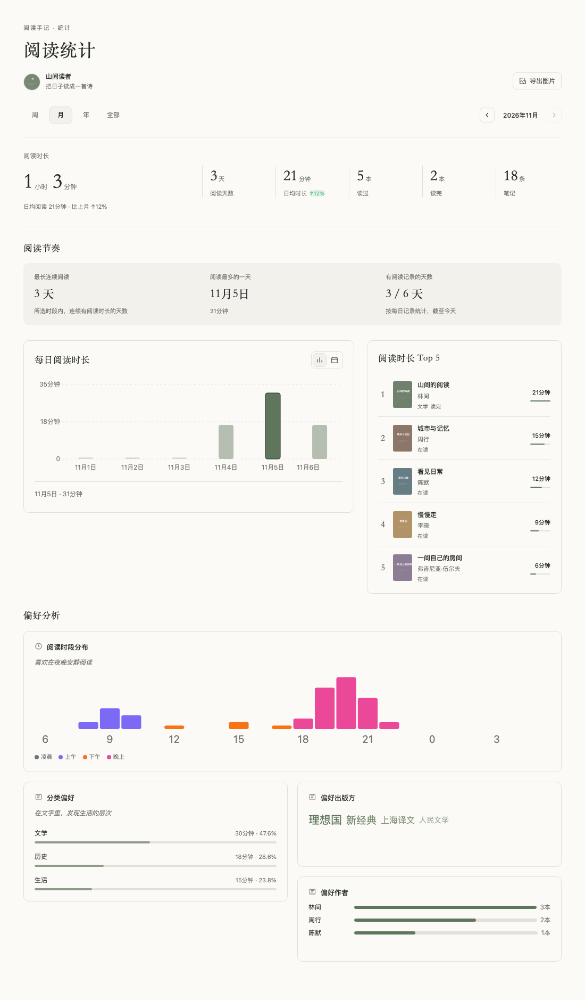

# Obsidian 微信读书插件

[](https://github.com/zhaohongxuan/obsidian-weread-plugin/releases/latest)
[](https://github.com/zhaohongxuan/obsidian-weread-plugin/actions/workflows/CI.yml)
[](https://github.com/zhaohongxuan/obsidian-weread-plugin/releases)
[](./LICENSE)

把微信读书的划线、想法和书评同步到 Obsidian，再通过书架、日历、阅读统计与收藏画布，重新发现自己的阅读记录。

[快速开始](#快速开始) · [界面预览](#界面预览) · [同步与数据](#同步与数据) · [使用文档](#使用文档) · [更新记录](https://github.com/zhaohongxuan/obsidian-weread-plugin/releases)

## 书架与阅读工作台

在同一个微信读书页面中切换 **今日 / 书架 / 回顾 / 收藏 / 统计**，图标配合文字显示，激活页面以主题色和下划线标识。页面按需加载，切换时保留筛选、浏览与滚动状态；书籍详情在页面内打开，通过面包屑返回。

今日和回顾采用单行头部：日期在左，缓存数量和更新时间靠右，最右侧的刷新图标可立即校验笔记。笔记时间显示到时分，列表标题旁的排序图标可切换最新或最早优先；原文、复制和收藏工具成组靠右。书籍详情将阅读进度放在阅读状态、时长的右侧，窄屏下自动换行。

下图为 **书架模式的封面视图**，展示真实书籍与文件夹；也可切换为默认的列表（封面＋详情）视图。



| 页面 | 可以做什么                                                                                 |
| ---- | ------------------------------------------------------------------------------------------ |
| 今日 | 查看今天的阅读时长、划线与想法，继续阅读最近翻开的书，从「旧句重逢」找回往日划线。         |
| 书架 | 搜索书籍、进入文件夹、筛选阅读和同步状态，在列表与封面视图间切换，打开详情或同步本地笔记。 |
| 回顾 | 按笔记创建日期浏览日历和「那年今日」，搜索全部已缓存笔记，跳转原文或复制正文。             |
| 收藏 | 星标个人划线，按列表、卡片或原生 Canvas 整理，搜索、排序、取消和撤销收藏。                 |
| 统计 | 查看周、月、年和累计阅读时长，以及热力图、阅读节奏、书籍排行和分类偏好。                   |

## 安装

需要 **Obsidian 1.1.9 或更新版本**。支持桌面端与移动端；收藏画布需要启用 Obsidian 内置的 **Canvas** 插件。

### 从社区插件安装

打开「设置 → 第三方插件 → 浏览」，搜索 `Weread`，安装并启用插件。

### 手动安装

从 [最新 Release](https://github.com/zhaohongxuan/obsidian-weread-plugin/releases/latest) 下载安装包，将其中的 `obsidian-weread-plugin` 文件夹放入笔记库的 `.obsidian/plugins/` 目录，随后在 Obsidian 中重新加载并启用插件。

也可以分别下载三个发布文件，目录结构应为：

```text
<笔记库>/.obsidian/plugins/obsidian-weread-plugin/
├── main.js
├── manifest.json
└── style.css
```

保留发布包中的文件名 `style.css`，不要改成 `styles.css`。更新已有安装时，请保留原目录中的配置和缓存文件。

## 快速开始

> **首次同步前请留意：同步会重新生成书籍笔记正文。** 个人批注和永久笔记建议保存在独立笔记中，通过 Obsidian 链接或块引用关联原文。插件保持从微信读书到 Obsidian 的单向同步，不会把本地修改写回微信读书。

1. **配置登录**：打开「设置 → Weread」。桌面端可使用「扫码获取」；也可手动填写 API Key。移动端可前往 [微信读书 Skills 页面](https://weread.qq.com/r/weread-skills) 获取 Key，再粘贴到设置中。
2. **选择保存位置与模板**：设置书籍笔记的保存位置，在「主题管理」选择同步模板。
3. **打开书架**：点击左侧微信读书图标，或在命令面板执行「打开微信读书书架」。
4. **同步笔记**：点击书架工具栏的同步按钮，或在命令面板执行「同步微信读书笔记」。左侧图标的右键菜单也提供同步入口。

### 登录方式与功能范围

建议优先配置 API Key；需要同步公众号文章笔记时，还需要有效 Cookie。

| 功能                             | 认证要求                                  |
| -------------------------------- | ----------------------------------------- |
| 普通书籍笔记同步、书架浏览       | API Key 或 Cookie                         |
| 阅读统计、社区热门划线、公开书评 | API Key                                   |
| 公众号文章的划线、想法与章节数据 | Cookie；仅填写 API Key 不足以使用这些接口 |

桌面扫码登录会获取 Cookie，并在验证成功后尝试获取 API Key。若某项功能不可用，请先检查对应凭据。API Key 不等同于微信读书网页的登录会话。

## 界面预览

<details>
<summary>今日：阅读概览、最近翻开的书与旧句重逢</summary>


今日与回顾共用本地笔记缓存。首次加载后默认每天校验一次，也可在设置中改为每天两次；「刷新笔记」可以立即校验。数量未变化时复用已缓存详情。

</details>

<details>
<summary>回顾：日历、历史笔记与那年今日</summary>


按创建日期查看个人划线和想法，日期背景随笔记数量增加而加深，悬停可查看具体数量；选定日期的笔记在独立区域内滚动。刷新和继续加载时保留位置，切换日期或筛选后回到顶部。

今日、回顾与收藏中的原文按钮遵循「阅读入口」设置：网页版会进入网页阅读器并尽量定位到原划线，App 使用 deeplink；网页阅读器也遵循新标签页或新窗口设置。缺少有效定位信息时打开对应书籍。

网页阅读器先打开对应章节，再定位划线；横向翻页与纵向阅读均以实际显示的正文为依据，笔记侧栏和隐藏预排版文字不算定位成功。同章节切换另一条划线时会重新定位，后一次点击会取消前一次尚未完成的查找。无法确认精确位置时会明确提示，不会把打开笔记列表当作成功。

日历反映的是已缓存笔记的创建历史，不能恢复没有记录的完整阅读轨迹。

</details>

<details>
<summary>书籍详情：章节划线、个人想法、热门划线和书评</summary>



在书架点击封面或标题即可进入详情，也可执行「打开当前书籍详情」。个人划线支持原文跳转、复制和星标收藏；从详情返回时保留来源页面的状态。

「刷新」重新读取详情，「同步笔记」才会更新本地书籍 Markdown。历史本地划线缺少来源 ID 或创建时间时，需要联网补齐后再收藏，以避免重复记录。

</details>

<details>
<summary>阅读统计：时长、节奏、排行与分类偏好</summary>



支持周、月、年和累计概览；周、月的连续阅读天数、峰值日期和活跃天数按每日阅读时长计算。热力图在窄屏中可以横向浏览。

</details>

## 收藏与 Canvas

在今日、回顾、那年今日、旧句重逢或书籍详情中，点击个人划线旁的星标即可收藏。收藏页左侧是窄搜索框，右侧可按收藏时间切换最新或最早优先，并通过图标切换卡片/列表视图。卡片使用浅主题色渐变与柔和阴影；取消后支持限时撤销。个人想法和社区热门划线暂不支持收藏。

点击工具栏最右侧的画布图标（「在Canvas中打开收藏」），或执行「打开微信读书收藏画布」，即可整理同一份收藏：

- **书籍封面卡片**：同一本书复用一个节点，展示封面、书名和作者。匹配到唯一的本地书籍笔记时显示「打开本地笔记」链接；没有本地笔记时不显示链接。
- **紧凑句子卡片**：展示正文与出处，不重复放置封面；默认宽 360px，高度按内容调整，手动修改过的尺寸和位置保留。
- **简洁连线**：只自动连接「书籍 → 句子」，不把所有书籍连接到「我的收藏」说明节点。
- **删除行为**：删除句子卡片会取消对应收藏；删除书籍卡片不会取消句子收藏，下次打开或保存时可补回书籍关联。

收藏默认保存在笔记库根目录的 `favorites.canvas`，可在「设置 → Weread → 书架设置 → 收藏画布保存目录」中更改。填写相对目录后点击「应用」，空目录表示根目录；切换前请先保存并关闭已打开的收藏画布。原目录文件会保留，目标已有收藏文件时停止迁移，不覆盖已有数据。

收藏不依赖登录状态。清理笔记缓存、退出登录或远端划线变化，不会自动清除收藏快照；在 Canvas 中主动编辑正文会更新本地收藏，不回写微信读书或书籍 Markdown。

备份笔记库时请包含所选目录中的画布、备份和迁移原件。旧版 `WereadData/favorites` 的收藏会校验后迁往设置的位置，原目录保留。首次层级迁移也会保留原始画布归档；已升级的画布需使用支持新格式的插件版本。多设备同时离线编辑不保证自动合并。更多迁移、原生编辑和恢复规则见 [收藏设计说明](./docs/favorites-design.md)。

## 常用设置

| 设置             | 默认或用途                                                                             |
| ---------------- | -------------------------------------------------------------------------------------- |
| 书架展示模式     | 默认「书架模式」，包含文件夹与书籍；「笔记本模式」聚焦有笔记的书和本地同步状态。       |
| 书架视图         | 默认列表（封面＋详情），可切换纯封面视图；按最近阅读排序。                             |
| 阅读入口         | 默认网页版，作用于书架、详情、今日、回顾与收藏；网页打开方式可另选新标签页或新窗口。   |
| 收藏画布保存目录 | 默认笔记库根目录，应用相对目录后安全迁移并保留原文件。                                 |
| 收藏默认视图     | 默认卡片，可切换列表。                                                                 |
| 旧句重逢排除书籍 | 在「书架设置」中点击「选择书籍」设置。只影响旧句重逢，不隐藏书架、日历或收藏中的书籍。 |
| 笔记缓存校验     | 默认每天一次，可改为每天两次；手动刷新可立即校验。                                     |
| 定时同步         | 默认关闭，可按需开启并配置间隔。                                                       |

「书架模式 / 笔记本模式」决定展示哪些书；「列表 / 封面视图」决定书籍如何呈现，两者可以分别选择。

## 同步与数据

### 普通同步与强制同步

普通同步会比较划线和想法数量，数量未变化时跳过更新。因此，远端正文编辑、划线位置调整或模板变更，可能不会仅凭数量检测触发重新生成。

需要重新生成时，可执行「强制同步微信读书笔记」。强制同步跳过数量检查，仍遵循已配置的同步过滤条件。同步过程遇到网络错误时，可检查登录与网络后重试。

同步支持书籍元数据、个人划线、想法、章节点评和书评；可配置文件命名、分类子目录及自定义 Frontmatter。社区热门划线需 API Key，并在设置中单独开启。

### Daily Notes

可把当天读书笔记的块引用插入 **已经存在** 的 Daily Note。请先配置 Daily Notes 的目录、日期格式及插入区间；使用 Periodic Notes 时，应填写与其一致的格式，例如 `YYYY/[W]ww/YYYY-MM-DD`。

插件会替换指定起止标记之间的内容，不会自动创建缺失的 Daily Note。个人文字请写在该同步区间之外。

### 同步模板

在「主题管理」中选择内置主题，或「复制并自定义」后编辑。这里的主题是同步笔记的内容模板。

| 内置主题         | 适合的组织方式                                 |
| ---------------- | ---------------------------------------------- |
| 合并式模板       | 将划线与想法穿插展示，适合顺着原文回顾。       |
| 分离式模板       | 将划线与笔记分区展示，适合集中整理。           |
| 微信官方笔记主题 | 展示书籍元数据和笔记，适合保留完整的书籍记录。 |

自定义主题支持编辑、复制及 JSON 导入导出，也可从 URL 导入。具体操作见 [模板编辑器使用说明](./docs/template-editor-window.md)。

## 常见问题

**点击左侧图标为什么没有开始同步？** 该图标用于打开书架。同步请使用书架工具栏、图标右键菜单，或命令「同步微信读书笔记」。

**修改模板后为什么笔记没更新？** 普通同步会跳过划线和想法数量未变化的书籍，可使用强制同步重新生成。请先备份个人修改。

**为什么有些功能提示需要 API Key 或 Cookie？** 不同接口的认证要求不同，参见上方的[功能范围](#登录方式与功能范围)。Cookie 或 Key 失效时需要重新配置；已配置 API Key 后，书架接口失败不会静默切换到另一个 Cookie 账号。

**为什么书籍卡片没有本地笔记链接？** 需要先同步出对应书籍笔记，并能通过 bookId 找到唯一匹配文件。只浏览远端书架不会自动创建本地笔记。

## 使用文档

- [版本更新与安装包](https://github.com/zhaohongxuan/obsidian-weread-plugin/releases)
- [V2 使用指南：认证与同步](./docs/weread-v2-guide.md)
- [模板编辑器使用说明](./docs/template-editor-window.md)
- [收藏画布与数据恢复规则](./docs/favorites-design.md)
- [使用 Dataview 管理书籍](https://github.com/zhaohongxuan/obsidian-weread-plugin/wiki/%E4%BD%BF%E7%94%A8Dataview%E8%BF%9B%E8%A1%8C%E4%B9%A6%E7%B1%8D%E7%AE%A1%E7%90%86)
- 开发参考：[Agent API](./docs/weread-agent-api.md) · [Cookie API](./docs/weread-api.md)
- [反馈问题或建议](https://github.com/zhaohongxuan/obsidian-weread-plugin/issues)

## 赞赏

如果这个插件对你有帮助，欢迎支持后续维护。


## 项目说明与致谢

本项目为非官方插件，用于整理本人账号可访问的阅读记录，不提供书籍正文下载。项目采用 [MIT 许可证](./LICENSE)。

感谢 [wereader](https://github.com/arry-lee/wereader)、[Kindle Plugin](https://github.com/hadynz/obsidian-kindle-plugin)、[Hypothesis Plugin](https://github.com/weichenw/obsidian-hypothesis-plugin)、[Obsidian Plugin Developer Docs](https://marcus.se.net/obsidian-plugin-docs/)、[http-proxy-middleware](https://github.com/chimurai/http-proxy-middleware) 和 [Nunjucks](https://github.com/mozilla/nunjucks)。

[](https://star-history.com/#zhaohongxuan/obsidian-weread-plugin&type=Timeline)
